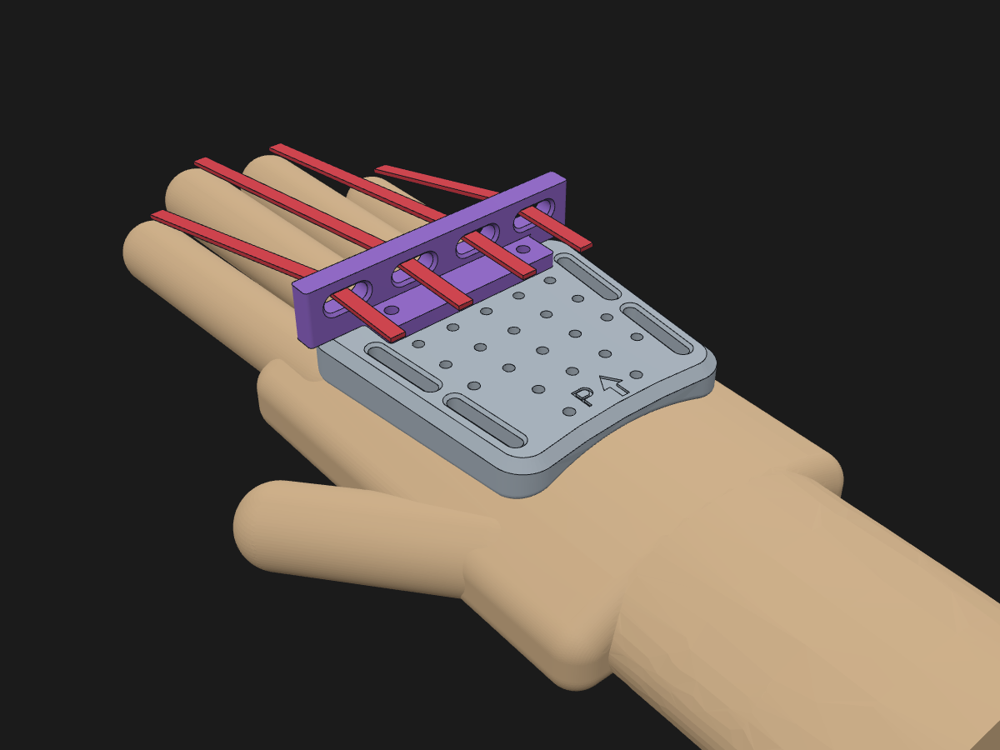
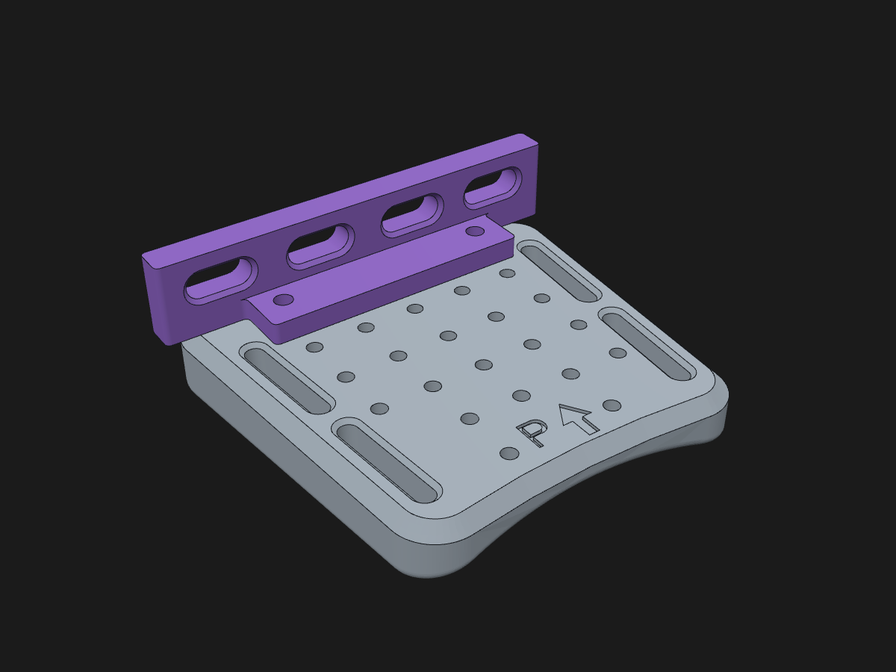
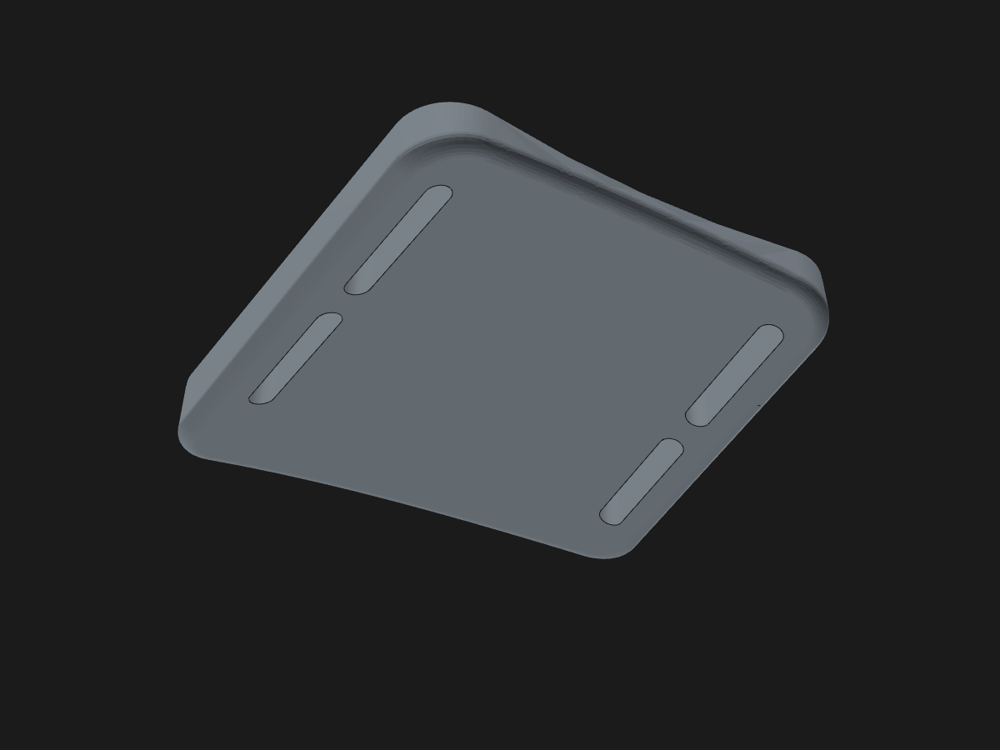
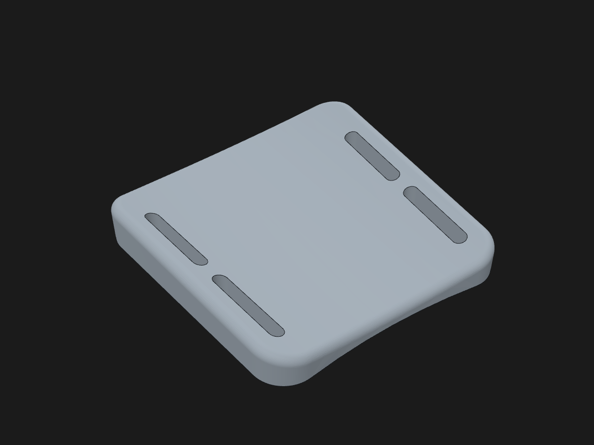

# Mocowanie na grzbiet dłoni

Płytka zakładana na grzbiet dłoni i zapinana na rzepy. Służy jako baza pod czujniki
albo silniki, które rejestrują ruch palców przez paski. Moduły na palce są osobno,
a ta część tylko trzyma się ręki i daje płaski blat z otworami, do którego można
przykręcić resztę.



| Płytka + prowadnica | Spód (strona skóry) | Pozycja do druku |
|---|---|---|
|  |  |  |

## Pliki

| Plik | Co to jest |
|---|---|
| `stl/plytka_dloni_prawa.stl`, `stl/plytka_dloni_lewa.stl` | Płytka, już obrócona do druku |
| `stl/prowadnica_palcow_prawa.stl`, `..._lewa.stl` | Opcjonalna prowadnica pasków od palców |
| `step/*.step` | Te same części w układzie dłoni, do edycji w CAD. Po zaimportowaniu płytki i prowadnicy obie trafiają na swoje miejsce. |
| `cad/mocowanie_dloni.py` | Parametryczny model (build123d), z którego generują się wszystkie pliki |

## Jak to jest zrobione

- Spód jest wklęsły (łuk o promieniu 90 mm), żeby pasował do poprzecznego wygięcia
  grzbietu dłoni. Blat jest płaski, więc łatwo zaprojektować pod niego mocowania czujników.
- Krawędź przednia jest skośna jak linia kłykci i kończy się przed nimi, więc pięść
  się zaciska. Tylna krawędź jest lekko wklęsła, żeby nie blokować odgięcia nadgarstka.
- Są 4 szczeliny na rzep 20 mm. Przedni pasek idzie przez wnętrze dłoni, między kciukiem
  a palcem wskazującym. Tylny pasek idzie wokół nasady dłoni.
- Siatka 26 otworów w rastrze 10 × 10 mm: Ø2,8 mm, głębokość 4,5 mm, nieprzelotowe,
  więc wkręt nie wyjdzie na skórę. Pasują wkręty M3 wkręcane w plastik. Jeśli wolisz
  wtapiane tulejki M3, ustaw `otwor_d = 4.0`.
- Na blacie jest wygrawerowane **P**/**L** i strzałka w stronę palców.
- Prowadnica (opcjonalna) ma 4 okna 12 × 5 mm z fazami, na paski od palca wskazującego,
  środkowego, serdecznego i małego. Przykręca się ją 2 wkrętami M3×8 do rzędu otworów
  najbliżej palców. To jest przykład, możesz ją zmienić albo zrobić własną.

Wymiary domyślne płytki to 73 × 75 mm, grubość 6 mm w środku i ok. 12,7 mm na brzegach.
Pasuje na średnią dorosłą dłoń, ok. 84 mm szerokości na kłykciach.

## Druk

- **Płytka**: blatem do stołu, tak jak jest w STL. Nie potrzebuje podpór, bo wklęsły spód
  jest wtedy na górze. PETG albo PLA, warstwa 0,2 mm, 3–4 obrysy, 20–25% wypełnienia
  (gyroid). Waży ok. 20–25 g.
- **Prowadnica**: stopką do stołu, bez podpór.

## Co dokupić

- Rzep 20 mm, 2 odcinki po ok. 30 cm (albo gotowe opaski rzepowe z klamrą).
- Samoprzylepna pianka EVA albo neopren 2–3 mm na spód płytki. Wyrównuje różnice
  w kształcie dłoni i poprawia wygodę.
- Wkręty M3×8 (albo tulejki M3 do wtapiania).

## Dopasowanie do swojej dłoni

Parametry są na górze pliku `cad/mocowanie_dloni.py` w klasie `Param`. Najważniejsze:

| Parametr | Domyślnie | Jak dobrać |
|---|---|---|
| `dlugosc` | 76 | Długość grzbietu dłoni od zgięcia nadgarstka do kłykci minus ok. 25 mm |
| `szerokosc_przod` | 74 | Szerokość dłoni na kłykciach (palce II–V) minus ok. 10 mm |
| `szerokosc_tyl` | 62 | Szerokość przy nadgarstku |
| `promien_luku` | 90 | Mniej, jeśli płytka „kiwa się” na boki. Więcej, jeśli uciska brzegami |
| `szerokosc_paska` | 20 | Szerokość rzepu. Przy 25 mm zwiększ też `dlugosc` do ok. 85 |
| `paski_y` | (19, 45) | Położenie pasków wzdłuż dłoni |
| `palce_x` | (-29, -10, 9, 27) | Osie palców (dla prawej ręki) do okien prowadnicy |
| `otwor_d` | 2.8 | 2.8 dla wkrętów w plastik, 4.0 dla tulejek wtapianych |

Po zmianie parametrów wygeneruj pliki od nowa:

```bash
pip install -r requirements.txt
python cad/mocowanie_dloni.py
```

Skrypt nadpisuje pliki w `step/` i `stl/`, dla prawej i lewej ręki.

## Układ współrzędnych (pliki STEP)

Prawa ręka, grzbietem do góry:

- **+Y** w stronę palców,
- **+X** w stronę małego palca (kciuk jest po stronie −X),
- **+Z** od grzbietu dłoni w górę. `z = 0` to najwyższy punkt skóry pod płytką,
  a blat jest na `z = 6`.

Wersja lewa to lustro względem płaszczyzny YZ.
